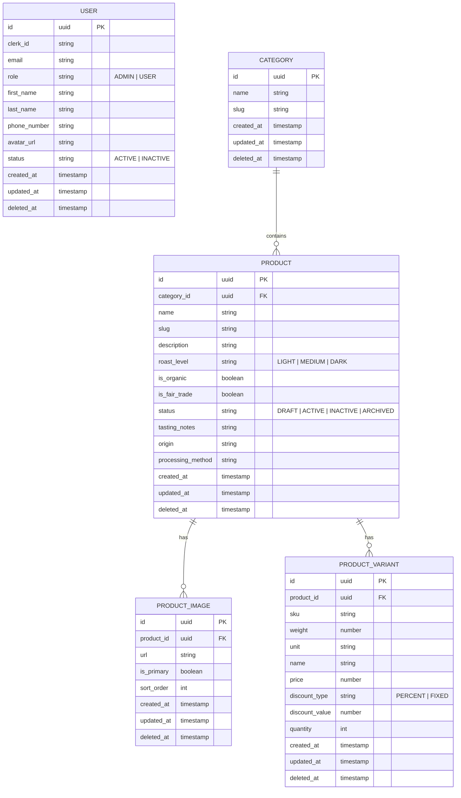

# Coffee Shop API

A NestJS backend for a coffee shop catalog — Clerk-authenticated users, role-based
access (Admin/User), and catalog management (categories, products, variants, images) backed by
PostgreSQL via MikroORM.

**Live:** [Website](https://ai-training-develop.vercel.app/) ·
[API Swagger](https://ai-training-develop.onrender.com/api/docs)

## Table of Contents

- [Tech Stack](#tech-stack)
- [Getting Started](#getting-started)
- [Features](#features)
- [Project Structure](#project-structure)
- [Entity Relationship Diagram (ERD)](#entity-relationship-diagram-erd)
- [API Endpoints](#api-endpoints)
- [Database & Migrations](#database--migrations)
- [Testing](#testing)
- [Deploy](#deploy)

## Tech Stack

- [Node.js](https://nodejs.org) v24 (ESM)
- [TypeScript](https://www.typescriptlang.org) v6
- [NestJS](https://nestjs.com) v12
- [Clerk](https://clerk.com) (`@clerk/express` v2)
- [Svix](https://www.svix.com) v1
- [PostgreSQL](https://www.postgresql.org) v18
- [MikroORM](https://mikro-orm.io) v7
- [Zod](https://zod.dev) v4
- [class-validator](https://github.com/typestack/class-validator) v0.15
- [`@repo/constants`](../../packages/constants) (workspace)
- [Vitest](https://vitest.dev) v5
- [Supertest](https://github.com/ladjs/supertest) v7
- [Swagger](https://swagger.io) (`@nestjs/swagger` v12)
- [`@nestjs/observe`](https://www.npmjs.com/package/@nestjs/observe) v0.3
- [Docker](https://www.docker.com) + [Docker Compose](https://docs.docker.com/compose/)

## Getting Started

### Prerequisites

- [Node.js](https://nodejs.org) >= 24
- [pnpm](https://pnpm.io) 10.34.5 (pinned by `packageManager` in the root `package.json`)
- [Docker](https://www.docker.com) + [Docker Compose](https://docs.docker.com/compose/) (for running PostgreSQL, or the whole stack, in containers)
- A [Clerk](https://clerk.com) application (publishable key, secret key, webhook signing secret)

### Installation

1. Clone the repo and install the workspace at the root. This also builds `@repo/constants` and
   installs the git hooks.

   ```bash
   git clone -b develop git@github.com:tiennguyen-agilityio/ai-training.git
   cd ai-training && pnpm install
   cd apps/api
   ```

2. Create `.env` and `.env.docker` (both are needed) and fill them in, see
   [Environment Variables](#environment-variables).

   ```bash
   cp .env.example .env
   cp .env.example .env.docker
   ```

3. Start PostgreSQL only (the dev override exposes its port); the app runs on the host.

   ```bash
   docker compose --env-file .env -f docker-compose.yml -f docker-compose.dev.yml up -d postgres
   ```

4. Apply the migrations.

   ```bash
   pnpm run migration:up
   ```

5. Start the API from the repo root (see [Running Locally](#running-locally)).

   ```bash
   pnpm dev:api
   ```

   The API listens on `http://localhost:<PORT>`; Swagger is at `/api/docs`.

### Environment Variables

`.env.example` lists every variable; the app checks them at startup
(`src/configs/env.validation.ts`) and does not boot if one is missing or empty.

- `APP_KEY` and `APP_SECRET` are optional: delete their lines instead of leaving them empty.
- `.env`: `NODE_ENV=development`, `PORT=3000`, `CORS_ORIGIN=http://localhost:3001`,
  `DB_HOST=localhost`, `DB_PORT=5432`.
- `.env.docker`: the same values as `.env`, except `DB_HOST=postgres` and `DB_PORT=5432`.

| Variable                | Description                                                                          |
| ----------------------- | ------------------------------------------------------------------------------------ |
| `NODE_ENV`              | `development` \| `test` \| `production`                                              |
| `PORT`                  | HTTP port the API listens on                                                         |
| `DB_HOST`               | PostgreSQL host                                                                      |
| `DB_PORT`               | PostgreSQL port                                                                      |
| `DB_NAME`               | PostgreSQL database name                                                             |
| `DB_USER`               | PostgreSQL user                                                                      |
| `DB_PASSWORD`           | PostgreSQL password                                                                  |
| `CORS_ORIGIN`           | Allowed origins, comma-separated; `*` matches one run of lowercase letters or digits |
| `THROTTLE_TTL`          | Rate-limit window, in milliseconds                                                   |
| `THROTTLE_LIMIT`        | Max requests per IP per `THROTTLE_TTL` window                                        |
| `CLERK_SECRET_KEY`      | Clerk backend secret key                                                             |
| `CLERK_PUBLISHABLE_KEY` | Clerk publishable key                                                                |
| `CLERK_WEBHOOK_SECRET`  | Clerk webhook signing secret                                                         |
| `APP_KEY`               | Nest Observe app key                                                                 |
| `APP_SECRET`            | Nest Observe app secret                                                              |

### Running Locally

From the repo root, `pnpm dev:api` is the recommended way: it runs `nest --watch` together with
`tsc --watch` for `@repo/constants`, so changes to the shared package are rebuilt.

From `apps/api/`:

```bash
pnpm run start          # run
pnpm run start:dev      # watch mode (does not rebuild @repo/constants)
pnpm run start:prod     # run compiled dist/main.js
```

### Running with Docker

```bash
pnpm run docker:dev        # app + PostgreSQL, hot reload
pnpm run docker:dev:down

pnpm run docker:prod       # app + PostgreSQL, detached
pnpm run docker:prod:down
```

## Features

### Auth & Authorization

- **Authentication** — Clerk sign-in; the API verifies Clerk session tokens.
- **User sync** — Clerk webhooks keep PostgreSQL in sync with Clerk.
- **Authorization** — two roles: **Admin** (full CRUD) and **User** (own profile, read-only
  catalog). Catalog reads are public.

> **Running locally:** a user exists in the database only after Clerk's webhook reaches
> `POST /webhooks/clerk` (Svix signature), so Clerk needs a public URL that reaches your local
> API; until then a signed-in user gets `401` from `/users/me`. The admin role comes from the
> user's `public_metadata.role` on Clerk (without it the user is a regular User).

### Catalog Management

- **Users** — CRUD with search, role and status filters, pagination.
- **Categories** — CRUD with unique name and auto-generated slug.
- **Products** — CRUD with images (2 to 6 at create, one primary) and variants; filter, search, sort and
  pagination.
- **Soft delete** — deleted rows are hidden by default and visible to active admins.

### Cross-cutting

- Environment validation at startup
- CORS allow-list
- Helmet security headers
- Rate limiting
- Consistent HTTP responses and errors
- Zod request validation
- Swagger-documented API (disabled when `NODE_ENV=production`)

## Project Structure

```text
apps/api/
├── src/
│   ├── common/                 # Shared code used by several modules
│   │   ├── constants/          # Shared constants
│   │   ├── decorators/         # Custom decorators
│   │   ├── dto/                # Shared DTOs and schemas
│   │   ├── entities/           # Base entities
│   │   ├── exceptions/         # Domain exceptions
│   │   ├── filters/            # Exception filters
│   │   ├── guards/             # Auth and role guards
│   │   ├── interceptors/       # Response interceptors
│   │   ├── interfaces/         # Shared interfaces
│   │   ├── middlewares/        # Request middlewares
│   │   ├── providers/          # Auth provider
│   │   ├── repositories/       # Base repository
│   │   └── utils/              # Helper functions
│   ├── configs/                # App and env configuration
│   ├── migrations/             # Database migrations
│   ├── modules/
│   │   └── <feature>/          # One folder per feature
│   │       ├── controllers/    # HTTP routes
│   │       ├── dto/            # Request schemas and response DTOs
│   │       ├── entities/       # Database entities
│   │       ├── repositories/   # Data access
│   │       ├── services/       # Business logic
│   │       └── <feature>.module.ts
│   ├── types/                  # TypeScript declarations
│   ├── app.module.ts           # Root module
│   └── main.ts                 # App bootstrap
└── test/
    ├── baseline/               # Response capture
    ├── e2e/                    # End-to-end tests
    ├── utils/                  # Test helpers
    ├── setup-env.ts            # Loads .env.test
    └── reset-test-db.ts        # Resets the test database
```

## Entity Relationship Diagram (ERD)



## API Endpoints

> Base path: `/api/v1` - API docs `/api/docs` (non-production only).
>
> **Auth:** 🔓 Public · 🔒 Authenticated (Clerk session token) · 👑 Admin

### Users

| Method   | Path         | Auth | Description                                              |
| :------- | :----------- | :--- | :------------------------------------------------------- |
| `GET`    | `/users/me`  | 🔒   | Get authenticated user profile                           |
| `GET`    | `/users`     | 👑   | List users (search, role and status filters, pagination) |
| `GET`    | `/users/:id` | 👑   | Get user by ID                                           |
| `PATCH`  | `/users/:id` | 👑   | Update user                                              |
| `DELETE` | `/users/:id` | 👑   | Soft-delete user                                         |

### Categories

| Method   | Path                      | Auth | Description                   |
| :------- | :------------------------ | :--- | :---------------------------- |
| `GET`    | `/categories`             | 🔓   | List categories               |
| `GET`    | `/categories/:id`         | 🔓   | Get category by ID            |
| `POST`   | `/categories`             | 👑   | Create category               |
| `PATCH`  | `/categories/:id`         | 👑   | Update category               |
| `PATCH`  | `/categories/:id/restore` | 👑   | Restore soft-deleted category |
| `DELETE` | `/categories/:id`         | 👑   | Soft-delete category          |

### Products

| Method   | Path            | Auth | Description                                                                                              |
| :------- | :-------------- | :--- | :------------------------------------------------------------------------------------------------------- |
| `GET`    | `/products`     | 🔓   | List products (filter by category/status/roastLevel/price range, sort by name/price, search, pagination) |
| `GET`    | `/products/:id` | 🔓   | Get product by ID                                                                                        |
| `POST`   | `/products`     | 👑   | Create product (2–6 images with one primary, at least one variant)                                       |
| `PATCH`  | `/products/:id` | 👑   | Update product (add/update/remove images)                                                                |
| `DELETE` | `/products/:id` | 👑   | Archive + soft-delete product                                                                            |

### Webhooks

Not under `/api/v1` and excluded from Swagger.

| Method | Path              | Auth           | Description                                                      |
| :----- | :---------------- | :------------- | :--------------------------------------------------------------- |
| `POST` | `/webhooks/clerk` | Svix signature | Sync `user.created` / `user.updated` / `user.deleted` from Clerk |

## Database & Migrations

```bash
pnpm run migration:create   # generate a new migration from entity changes
pnpm run migration:up       # apply pending migrations
pnpm run migration:down     # revert the last migration
pnpm run seeder:create      # scaffold a seeder in src/seeders
pnpm run seeder:run         # run seeders
```

## Testing

```bash
pnpm run test          # unit tests (Vitest, *.spec.ts next to the source)
pnpm run test:watch
pnpm run test:cov
pnpm run test:e2e      # e2e tests (requires a reachable PostgreSQL — e.g. `pnpm run docker:dev`)
```

## Deploy

The API is deployed by GitHub Actions: `.github/workflows/ci.yml` calls the reusable
`.github/workflows/deploy-api.yml` after the `quality` and `build-and-scan` jobs pass. It builds
`apps/api/Dockerfile` (target `production`), pushes the image to GHCR, then deploys it on Render.

| Trigger                                      | Image tag               | Render service                                                              |
| -------------------------------------------- | ----------------------- | --------------------------------------------------------------------------- |
| Push to `develop`                            | `:develop` and `:<sha>` | develop service ([live](https://ai-training-develop.onrender.com/api/docs)) |
| Same-repo PR into `develop` that changes API | `:pull-request-<n>`     | preview `ai-training-api-preview-pull-request-<n>` (URL in the PR comment)  |

- A web-only PR gets no API preview; its web preview uses the develop API.
- Previews use the develop database, and CI never runs migrations. The PR comment warns when
  `src/migrations/` changes.
- `.github/workflows/preview-cleanup.yml` deletes a PR's API preview when the PR closes.
- `:develop` only ever holds merged code. No production deploy is configured.
