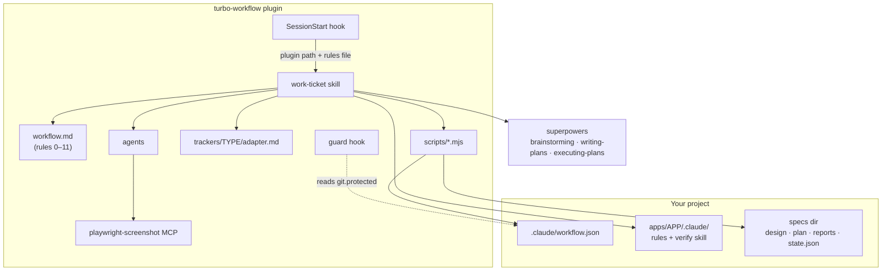

# Plugin internals

```text
.claude-plugin/marketplace.json      the marketplace (one plugin, relative source)
plugins/turbo-workflow/
  .claude-plugin/plugin.json         name, version, dependency on superpowers
  .mcp.json                          playwright-screenshot (pinned @playwright/mcp)
  hooks/                             hooks.json + session-start, block-forbidden-command, notify-on-finish
  skills/                            init, work-ticket (+ workflow.md, the rules), ticket-status, pr-description, ui-screenshot
  agents/                            plan-reviewer, pr-writer, trello-manager, ui-screenshotter
  scripts/                           config, changed-apps, coverage-diff, ticket-state, init-detect, vendor
  copy/skills/turbo-workflow-sync/   the sync skill, written only into copied projects
  trackers/<type>/adapter.md         trello (+ trello.yml template), none
  templates/                         test-report, pr-description, init/ skeletons
  schema/workflow.schema.json        the project config schema
  tests/                             node:test suites and fixture repos
```

## How the pieces connect



- **SessionStart hook.** A plugin cannot ship always-loaded rules, and `${CLAUDE_PLUGIN_ROOT}` is not set in Bash commands. So, when the project has `.claude/workflow.json`, the hook adds three lines to the session: the plugin's absolute path (written `<plugin>` in the rules), the rules file to read, and the ticket command. Without the file it only suggests `/turbo-workflow:init`.
- **`work-ticket` skill** runs steps 0–13 and reads `workflow.md` for the rules. It calls the scripts as `node "${CLAUDE_PLUGIN_ROOT}/scripts/…"` and talks to the tracker only through the adapter named by `tracker.type`.
- **`scripts/config.mjs`** is the one reader of `.claude/workflow.json`: it validates it and gives every package-manager command (`cmd run | exec | lockfile | build-packages`). The other scripts use it.
- **`scripts/ticket-state.mjs`** writes `state.json` (the saved status) and the fingerprint refs `refs/work-ticket/<feature>/`, and prints the status and the next action for a resume.
- **`scripts/changed-apps.mjs`** maps changed files to apps; **`coverage-diff.mjs`** snapshots and compares coverage.
- **`scripts/vendor.mjs`** makes and undoes the copy-mode project (`plan` / `show` / `write` / `remove`): a fixed list of plugin files → `.claude/` paths, one rewrite table (`${CLAUDE_PLUGIN_ROOT}/scripts/` and `<plugin>/scripts/` → `<repo root>/.claude/scripts/`, an absolute path Claude writes out, with no `$(…)` so no permission prompt, `turbo-workflow:<name>` → `<name>`, the plugin's MCP tool names → the project's, …), the `<!-- plugin-only -->…<!-- /plugin-only -->` and `<!-- copy: <name> -->` markers in the sources (the copy-only text lives in `vendor.mjs`, so plugin mode never reads it), a check that refuses to write when any plugin reference is left, the merge of the hooks into `.claude/settings.json` and of the screenshot server into `.mcp.json`, and the lock with a sha256 per file. `/turbo-workflow:init` and `/turbo-workflow-sync` only call it, so the same release always gives the same files.
- **`scripts/init-detect.mjs`** reads the repo (package manager, workspaces through `turbo ls`, apps and their scripts, git remotes, existing files) for init's suggested answers. It writes nothing.
- **Agents.** `plan-reviewer` checks each task's diff against the plan; `pr-writer` fills the PR template from facts only; `trello-manager` does every Trello read and approved move; `ui-screenshotter` takes screenshots through the plugin's MCP server.
- **Guard hook** (`PreToolUse`) blocks `--no-verify`, force pushes, pushes to `git.protected`, `rm -rf` on root paths, writes to secret files, discarding work, and piping downloads into a shell. Stack-specific rules (database, docker volumes) belong in a project hook.
- Every hook fails open: on any error it prints nothing and exits 0.
