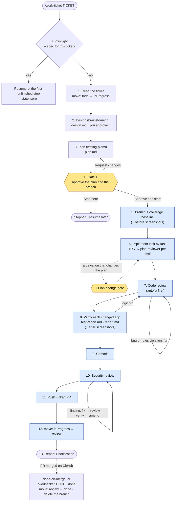
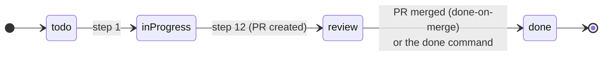
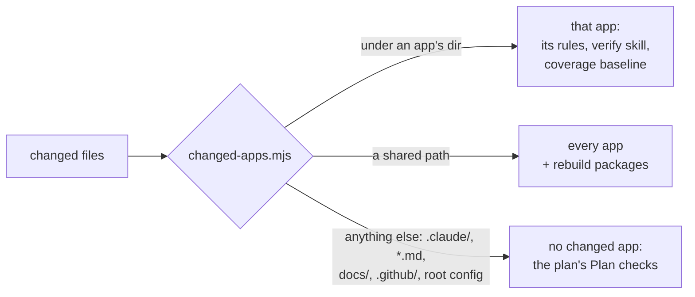

# How the workflow runs

`/work-ticket <ticket>` takes one ticket from the tracker to a draft GitHub PR (that is the name in a project set up in copy mode; in plugin mode it is `/turbo-workflow:work-ticket`, and the same goes for every command below). It drives the [superpowers](https://github.com/obra/superpowers) skills (brainstorming, writing-plans, executing-plans) and adds this plugin's own rules on top: reviews, verify per changed app, reports, saved status and tracker moves.

## The flow

- **Yellow**: a gate. The run stops and asks.
- **Blue**: runs without a question once Gate 1 is approved, including the commit, a security amend, the push and the draft PR.
- You mark the PR ready on GitHub yourself; the workflow never runs `gh pr ready`.

## When it asks you

| Moment | Question |
| --- | --- |
| Step 1 | The ticket is not in `todo` or `inProgress`: stop, or continue without moving it. A branch name that already exists: pick another |
| Step 2 | Clarifying questions while designing, then approval of `design.md` |
| Gate 1 | Approve and start · Stop here · Request changes |
| Step 6 | Plan-change gate: a deviation that changes an acceptance criterion, the scope, the changed apps, a dependency or an unlisted file |
| Steps 7, 8, 10 | Round limit: after 3 fix rounds before the commit (or 3 after it), the run stops and asks |
| Step 11 | A failed push or `gh pr create`: the run stops and notifies; a resume runs step 11 again |

Every question uses one format: option A is "(Recommended)", then B and C, and D ("Other") for your own answer. At each gate and on a failure, a desktop notification (macOS) says what is needed.

## Ticket states

The tracker adapter makes these moves (`trello`: lists on a board). With tracker `none` the moves are skipped. Any other write to the tracker needs a gate.

## What a run produces

| File | Where | Committed |
| --- | --- | --- |
| `design.md`, `plan.md` | `<specsDir>/<date>/<feature>/` | no (specs dir is gitignored) |
| `state.json` (saved status) | same dir | no |
| `coverage-baseline-<app>.json` | same dir | no |
| `test-report.md` (each verify run), `report.md` | same dir | no |
| `pr-description.md` | same dir | no (it becomes the PR body) |
| Before / after screenshots (UI changes only) | the app's `screenshot.dir` | yes, with the code |
| Plan ledger | `.superpowers/sdd/` | no (gitignored) |
| The code, its tests | the repo | yes: one Conventional Commits commit |

## Changed apps decide the checks

`scripts/changed-apps.mjs` maps the changed files to apps in `.claude/workflow.json`:

Verify runs each changed app's own `apps/<app>/.claude/skills/verify/SKILL.md` (lint without `--fix`, format check, build, unit with coverage, e2e when on). Coverage is compared with the baseline taken before any code change; drops are warnings.

## Resume

A stopped run continues where it stopped: run `/work-ticket <ticket>` (or `<spec dir>`) again. `state.json` records the step, the task and its step, tests passed, review results, findings and rounds. Local git refs under `refs/work-ticket/<feature>/` fingerprint the work, so the resume can tell when files changed while it was away. `/ticket-status` shows where a run is without changing anything.
